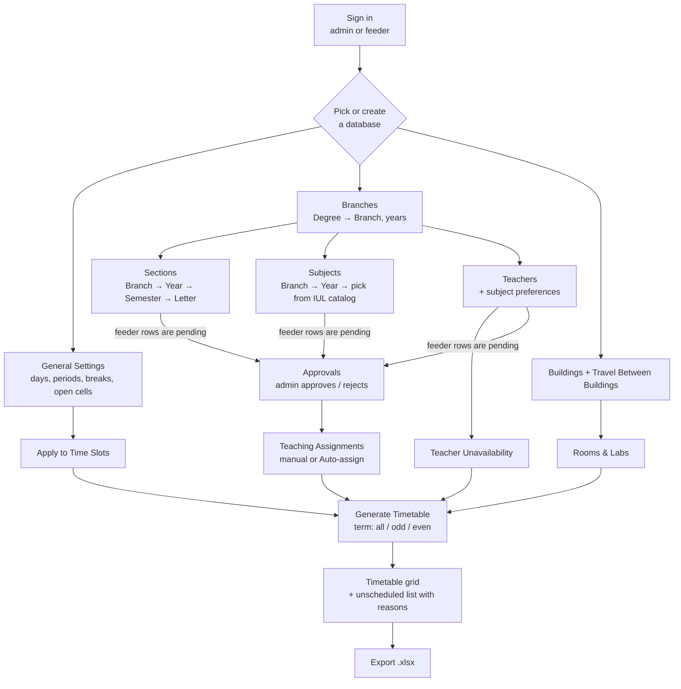
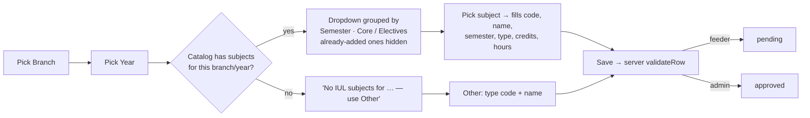
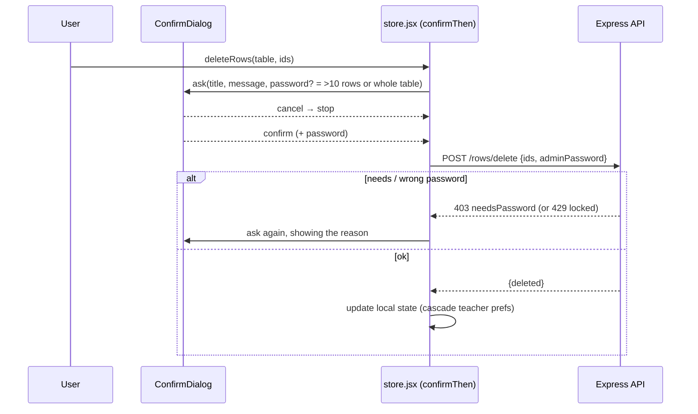
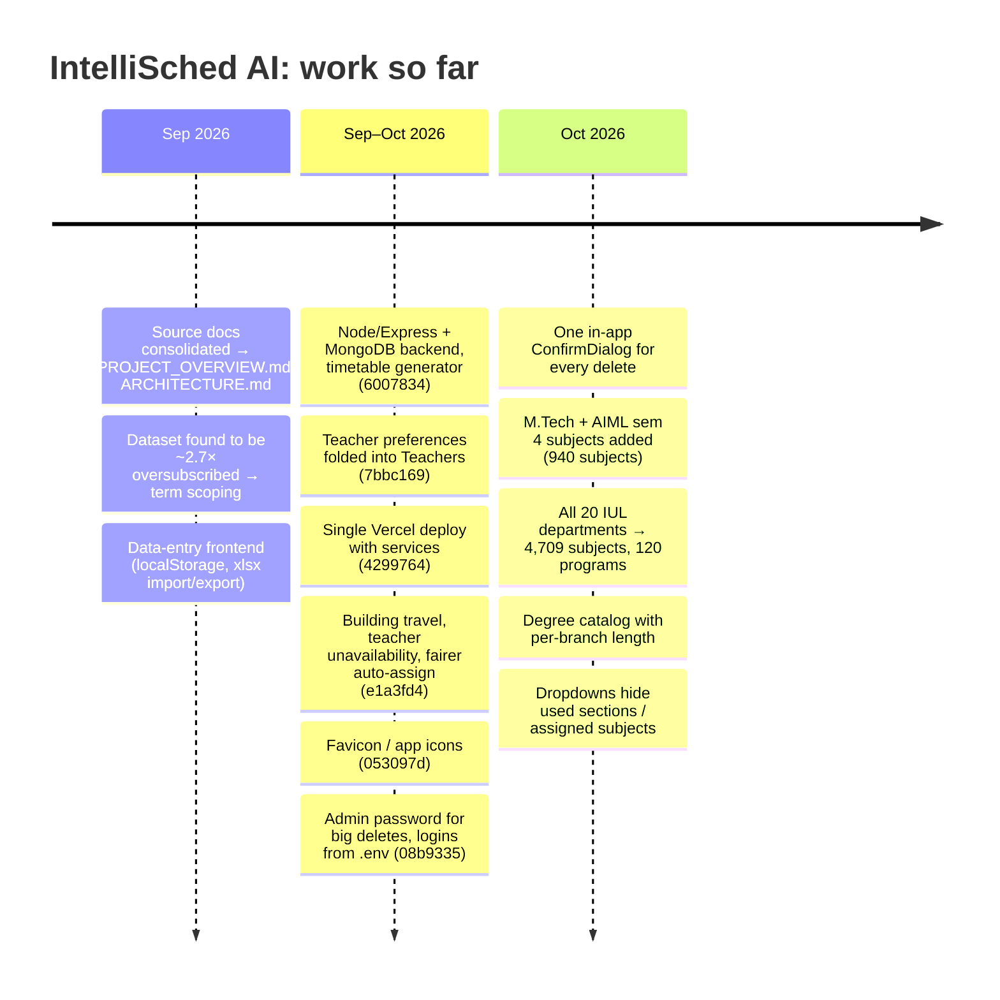

# IntelliSched AI: Flow

Two flows, up to October 2026:

1. **How the app works:** how a user's data becomes a timetable.
2. **How the project got here:** the order the work happened in.

Diagrams are Mermaid; they render on GitHub and in VS Code with a Mermaid preview.

---

## 1. How the app works

### 1.1 End to end

### 1.2 Entering a subject

### 1.3 Deleting (one dialog)

### 1.4 How the generator decides

1. **Expand the demand.** For each section, take every subject of its branch and semester. Each subject becomes sessions:
   - theory: 1-period sessions, one per weekly hour;
   - lab: 2-period sessions, plus a 1-period session if the hours are odd.
2. **Reject what can't be attempted:** no teacher assigned, no rooms of the right type, or no classroom big enough.
3. **One greedy run.** For each session, try every open (day, period) and every room. Keep only the legal options:
   - no clashes;
   - within the teacher's load and outside their unavailability;
   - no lab across a break;
   - enough walking time between buildings.

   Score each legal option; lower is better:
   `10 × same subject that day + 2 × section's load that day + teacher's load that day + 4 × building changes + not the home block + random jitter`
4. **Repeat 30 times and keep the best run:** the most sessions placed, then the lowest score. Report everything unplaced with a reason.

### 1.5 Who can do what

| Action | Feeder | Admin |
|---|---|---|
| Add / edit rows | yes (saved as `pending`) | yes (saved as `approved`) |
| Delete rows | only their own pending rows | any; more than 10 rows or a whole table needs the admin password |
| Approve / reject | no | yes |
| Branches, Teaching Assignments, Settings, Generate | no | yes |
| Create / delete databases | no | yes (deleting one needs the password if it has more than 1 row) |

---

## 2. How the project got here

### 2.1 The October session, step by step

| # | Request | What was done | Checked by |
|---|---|---|---|
| 1 | "How to run this project" | Gave the two `npm run dev` commands | – |
| 2 | Subjects from iul.ac.in; dropdown empty; fix the delete UI | Found the dropdown worked, but the catalog lacked EEE, sem 8, AIML 4+, M.Tech. Added M.Tech for 11 branches and AIML sem 4 (+250). Explained empty cases in the dropdown. Replaced every `window.confirm` and the two-step password prompt with one `ConfirmDialog`. | Headless Chrome: dialogs open and cancel, 0 data-changing requests, 0 errors; lint |
| 3 | "Add the rest of the departments; hide used options, also for sections" | Downloaded 872 PDFs and extracted about 17k rows. Hand-read about 40 scanned pages. Mapped 122 programs and merged 3,769 subjects. Added new degrees and branches with per-branch length. Hid used section letters and assigned subjects. | Catalog checks (no duplicates, semesters within length, no orphan branches); headless Chrome on Branches, Subjects, Sections; lint |
| 4 | "Check Dr. Vihaan Iyer" | Teacher TT0010 (DSAI): approved, 2 valid preferences, 0 assignments, so not yet in any timetable | Live API read + Teachers screenshot |
| 5 | Restart servers | Started both. Found port 5173 held by the CarRental project and a second IntelliSched frontend on 5174. Stopped the duplicate. The servers were later stopped by low memory (about 1.9 GB free). | curl on 4000 / 5174 |

### 2.2 Problems hit along the way and how they were solved

| Problem | Fix |
|---|---|
| Half-installed frontend `node_modules` broke Vite | `rm -rf node_modules && npm ci` |
| Table routes are case-sensitive (`table/teachers` shows Overview) | Use `table/Teachers` |
| PDF tables with blank spacer columns broke the hour parsing | Drop empty cells before reading L-T-P |
| NEP codes (`B010301T/PY207`, `A040601T`) not recognised | Widened the code pattern |
| "Semester: Fifth", "Year/Semester: I / II" missed | Rewrote the semester pattern (word forms, year/semester pairs) |
| Scanned PDFs, no OCR installed | Rendered with Ghostscript and read by eye |
| Credits read from a marks column (5 credits for 2 hours) | Credits above the weekly hours are recomputed |
| Theory papers mis-typed as Lab from a mislabelled syllabus page | Names come from rows that carry hours; type decided by hours |
| Shell heredocs turned `\b` into backspace characters | Rewrote the affected lines and replaced stray `\x08` |
| Node's DNS SRV lookup to Atlas failed once | Restarting fixed it (Windows resolved fine) |
| Dev servers killed under memory pressure | Run them in your own terminal; close other dev servers |
